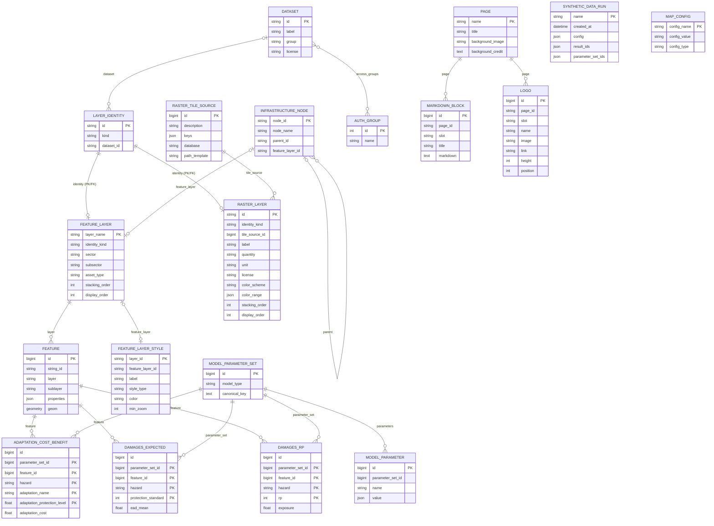

# Database entity relationship diagram

This diagram reflects the current Django model definitions in `irvapp/map/models/`, `irvapp/raster/models.py`, and `irvapp/content/models.py`. Django's built-in `auth.Group` is shown because datasets reference it. Unmanaged/external tables and implicit tree-query fields are omitted. Entity attributes are abbreviated to keep the diagram readable.

Notes: layer identities are shared IDs with one-to-one subtype rows; `identity_kind` is constrained to the corresponding subtype. Feature layer styles retain their original ID until a matching feature layer is available; linked IDs must match. Result tables use composite primary keys (shown with `PK` on each constituent) and also have unique sequence-backed `id` values. `ModelParameterSet` has a unique constraint on `(model_type, canonical_key)`; `ModelParameter` on `(parameter_set_id, name)`; `MarkdownBlock` on `(page_id, slot)`. `SyntheticDataRun` stores IDs in JSON, not relational foreign keys.
